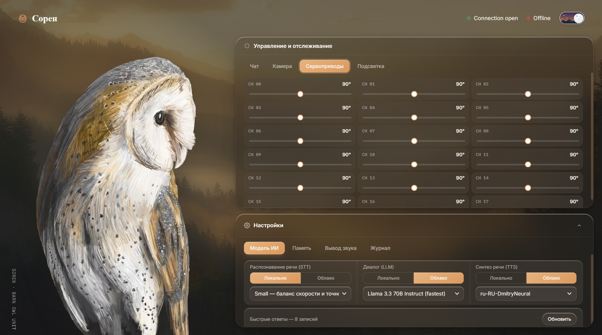

<div align="center">

# 🦉 AI Robot Server — Сорен

**Локальный AI-сервер для роботизированной совы на ESP32-S3**
Голосовое управление · Компьютерное зрение · 22 сервопривода

<p align="center">
  
</p>

[](#требования)
[](#технологический-стек)
[](./LICENSE)
[](#требования)

</div>

---

## О проекте

**Сорен** — амбарная сова, страж Великого Древа Га'Хула из книг Кэтрин Ласки «Легенды ночных стражей», воплощённая в виде физического робота на базе **ESP32-S3**. Этот репозиторий — серверная часть проекта (прошивка и 3D-модели лежат отдельно, см. [AI Robotic Owl](#связанные-части-проекта)): локальный AI-сервер, который распознаёт речь, генерирует ответы в характере персонажа, синтезирует голос и управляет 22 сервоприводами робота в реальном времени.

Проект объединяет полный voice AI pipeline (STT → LLM → TTS), компьютерное зрение и физическое поведение робота в единую систему с веб-панелью управления.

### Ключевые возможности

- 🎙️ **Голосовой диалог** — распознавание речи, генерация ответа персонажа, синтез голоса
- 🧠 **LLM-персонаж с памятью** — Qwen 7B (дообученный на датасете персонажа) + векторная память (Qdrant) + RAG по биографии и миру Сорена
- 👁️ **Компьютерное зрение** — детекция объектов (YOLOv8), трекинг позы и лиц (MediaPipe/OpenCV)
- 🎭 **Эмоциональный движок** — 7 эмоциональных состояний с уникальными позами сервоприводов и подсветкой глаз
- 🔀 **Local / Cloud переключение** — каждый AI-модуль (STT, LLM, TTS) можно переключать между локальным инференсом и облачным API одной кнопкой
- 🦾 **Управление 22 сервоприводами** — голова, клюв, крылья, хвост, лапы, таз
- 🌐 **Веб-панель управления** — голосовой и текстовый чат, ручное управление сервоприводами, переключение режимов, анимации

---

## Демонстрация переключения Local / Cloud

Каждый AI-модуль имеет независимую кнопку переключения режима — удобно для баланса между приватностью/офлайн-работой и качеством/скоростью.

| Модуль     | Локально                   | Облачно                         |
| ---------- | -------------------------- | ------------------------------- |
| **STT** 🎤 | faster-whisper (~500 МБ)   | —                               |
| **LLM** 🧠 | Qwen 2.5 7B GGUF (~4.5 ГБ) | GitHub Models API (gpt-4o-mini) |
| **TTS** 🔊 | Silero (~120 МБ)           | edge-tts (Microsoft, бесплатно) |

---

## Технологический стек

`FastAPI` · `faster-whisper` · `llama-cpp-python` · `PyTorch / Silero` · `edge-tts` · `YOLOv8` · `MediaPipe` · `OpenCV` · `webrtcvad` · `Qdrant`

| Компонент               | Технология                                    | Назначение                       |
| ----------------------- | --------------------------------------------- | -------------------------------- |
| WebSocket / HTTP сервер | FastAPI + Uvicorn + websockets                | API для ESP32 и веб-панели       |
| STT (речь → текст)      | faster-whisper                                | Распознавание речи (локально)    |
| LLM (языковая модель)   | llama-cpp-python / GitHub Models API          | Генерация ответов Сорена         |
| TTS (текст → речь)      | Silero (PyTorch) / edge-tts                   | Синтез голоса                    |
| Долгосрочная память     | Qdrant (векторная БД)                         | Память диалогов и контекста      |
| Vision                  | Ultralytics YOLOv8 + MediaPipe + OpenCV       | Детекция объектов, позы, лиц     |
| Audio VAD               | webrtcvad                                     | Определение начала/конца речи    |
| Fine-tuning             | PEFT (LoRA/QLoRA) + Transformers + Accelerate | Дообучение LLM на персонаже      |
| Аудиообработка          | soundfile + librosa                           | Конвертация форматов, ресемплинг |
| Конфигурация            | python-dotenv                                 | Переменные окружения             |

---

## Архитектура

```
ESP32-S3 (робот) ──WebSocket──▶  FastAPI-сервер  ──▶  STT → LLM → TTS
     ▲   22 сервопривода              │
     │   микрофон / динамик            ├──▶ Vision (YOLOv8, MediaPipe)
     │   камера                        ├──▶ Эмоциональный движок → позы сервоприводов
     └──────────── аудио/команды ◀─────┴──▶ Веб-панель управления (/panel)
```

---

## Быстрый старт

### 1. Установка зависимостей

```bash
python -m venv venv
venv\Scripts\activate      # Windows
source venv/bin/activate   # Linux / macOS

pip install -r requirements.txt
```

### 2. Настройка конфигурации

```bash
cp .env.example .env
# укажи GITHUB_MODELS_KEY в .env, если нужен облачный LLM
```

### 3. Загрузка моделей

```bash
python scripts/download_qwen.py             # LLM — Qwen 7B GGUF
python scripts/download_yolo.py             # Vision — YOLOv8
python scripts/download_face_detector.py    # детектор лиц OpenCV DNN (опционально)
# Whisper и Silero скачаются автоматически при первом запуске
```

### 4. Быстрые ответы (опционально)

```bash
python scripts/build_audio_cache.py   # заранее озвучивает character/quick_answers.json
```

### 5. Запуск сервера

```bash
python websocket_server.py
```

Панель управления будет доступна по адресу: **http://localhost:8765/panel**

---

## Веб-панель управления

Панель (`/panel`) объединяет всё управление роботом в одном интерфейсе:

- Переключение режимов **Local / Cloud** для STT, LLM и TTS
- Переключение аудио-ввода (микрофон) и аудио-вывода (динамик)
- Голосовой чат и текстовый чат с Сореном
- Запуск анимаций: `wave`, `nod`, `shake_head`, `idle`
- Ручное управление каждым из 22 сервоприводов
- Вкладка «Движение»: режим управления (ручной / автономный), кнопки **«2 шага вперёд»** и **«Пролететь 5 м»**, схема геймпада в реальном времени
- Светлая и тёмная темы, отображение статуса сервера и AI-модулей

Заданные движения не прерываются: кнопки «Стоп» в панели нет, пока одно движение выполняется, новое не принимается. Команда `walk` принимает `distance_cm` или `steps`, `fly` — `distance_cm`.

---

## Геймпад

DualShock 4, подключённый к ПК по Bluetooth, читается через `pygame` (опционально — без него модуль тихо отключается). Левый стик — ходьба и поворот, ✕ — взлёт, ○ — посадка. □, △, L1, R1 и аналоговые триггеры L2/R2 выводятся в панели, но пока ни за что не отвечают.

Индексы осей и кнопок заданы в `modules/gamepad_input.py` (раздел `TUNE`); проверить их на своём геймпаде можно командой `python -m pygame.examples.joystick`. Подробности — в [docs/CONTROL.md](docs/CONTROL.md).

---

---

## Персонаж Сорен

### Память и знания (RAG)

База знаний персонажа включает биографию, отношения с ключевыми персонажами, лор мира Га'Хула и философию — используется для контекстно-точных ответов в характере персонажа. Долгосрочная память диалогов хранится в векторной БД Qdrant.

---

---

## API

| Endpoint      | Метод | Описание                             |
| ------------- | ----- | ------------------------------------ |
| `/`           | GET   | Статус сервера                       |
| `/status`     | GET   | Полный статус и режимы AI-модулей    |
| `/audio_mode` | POST  | Переключение аудио (вход/выход)      |
| `/ai_mode`    | POST  | Переключение AI-модуля (stt/tts/llm) |
| `/speak`      | POST  | Текст → LLM → TTS → аудио            |
| `/voice`      | POST  | Аудио → STT → LLM → TTS → аудио      |
| `/panel`      | GET   | Веб-панель управления (HTML)         |
| `/ws`         | WS    | WebSocket-канал для ESP32            |
| `/animations/reload` | POST | Перечитать character/animations/*.json |
| `/behavior/reload`   | POST | Перечитать character/behavior/rules.yaml |
| `/chat/history`      | GET  | Последние реплики диалога (общий чат панели: робот, микрофон ПК, текст) |
| `/chat/clear`        | POST | Очистить историю чата на сервере |
| `/favicon.svg`, `/favicon.ico` | GET | Иконка сайта |

---

## Скрипты

Все скрипты запускаются из любой папки: пути считаются от корня проекта.

| Скрипт | Назначение |
| ------ | ---------- |
| `scripts/download_qwen.py` | Скачивает локальную LLM (Qwen2.5-7B-Instruct GGUF) в `models/` |
| `scripts/download_yolo.py` | Скачивает `yolov8n.pt` в `models/` |
| `scripts/download_face_detector.py` | Скачивает детектор лиц OpenCV DNN (без него используется Haar Cascade) |
| `scripts/build_audio_cache.py` | Озвучивает быстрые ответы из `character/quick_answers.json` в `character/cache/` |
| `scripts/check_model.py` | Проверяет целостность скачанной GGUF-модели |
| `scripts/prepare_dataset.py`, `parse_curated.py`, `fine_tune.py`, `convert_lora_to_gguf.py` | Подготовка датасета и дообучение персонажа (LoRA) |

---

## Библиотека лора

В `library/` лежит база знаний по миру «Легенд ночных стражей»:

- `library/lib.jsonl` — записи лора (персонажи, группы, места и т.д.): по одной JSON-записи на строку с полями `id`, `kind`, `type`, `name`, `aliases`, `collections`, `text`, `tags`, `weight`, `source`, `canon`, `confidence`, `related`.
- `library/lotg_library_editor.exe` — редактор библиотеки (Windows).

---

---

## Требования

- **Python:** 3.10 – 3.11
- **ОЗУ:** от 8 ГБ (для локального Qwen 7B)
- **Диск:** ~5 ГБ под модели
- **ОС:** Windows 10/11, Linux, macOS

---

## Структура проекта

```
AI-Robot-Server/
├── websocket_server.py      # Главный WebSocket-сервер + веб-панель
├── config.yaml              # Основной конфиг (модели, сеть, режимы)
├── requirements.txt
├── .env.example             # Шаблон переменных окружения
├── config/                  # Загрузка настроек
├── modules/                 # AI-модули: stt, tts, llm, vision, robot_brain,
│                            #   servo_controller, motion_primitives, behavior,
│                            #   gamepad_input, audio_buffer, fuzzy_matcher, memory
├── character/               # System prompt, RAG-чанки, карта эмоций Сорена
│   ├── animations/          #   анимации серв (JSON, по одной на файл)
│   ├── behavior/rules.yaml  #   правила реакций на события опоры
│   └── cache/               #   заранее сгенерированные WAV быстрых ответов
├── library/                 # Библиотека лора (lib.jsonl) и её редактор
├── datasets/                # Датасеты для fine-tuning персонажа
├── scripts/                 # Загрузка моделей, аудио-кэш, подготовка датасета и fine-tuning
├── static/panel/            # Ассеты веб-панели (фон, сова, фавикон)
├── docs/                    # Документация
│   ├── BEHAVIOR.md          #   поведение: состояния, события, правила
│   ├── CONTROL.md           #   режимы управления и геймпад
│   ├── MOTION.md            #   примитивы движения
│   ├── STATES_AND_EVENTS.md
│   └── checklists/          #   чек-листы углов серв (взлёт/посадка, ходьба/полёт)
└── .github/                 # CI
```

Создаются при работе сервера и не хранятся в репозитории: `models/`, `memory/`, `qdrant_storage/`, `llama-bin/`.

---

## Связанные части проекта

- **Прошивка ESP32-S3, подключение электроники и распиновка** — `arduino-owl-model/README.md`
- **3D-модели корпуса** — `3d-model-for-owl/README.md`
- **Общее описание проекта** — корневой `README.md` репозитория AI Robotic Owl

Плата подключается к серверу по WebSocket (`/ws`, порт 8765); адрес сервера задаётся в прошивке, ключ устройства — переменной `DEVICE_KEY` в `.env`.

---

## Лицензия

Проект распространяется под лицензией **[MIT](./LICENSE)**.
